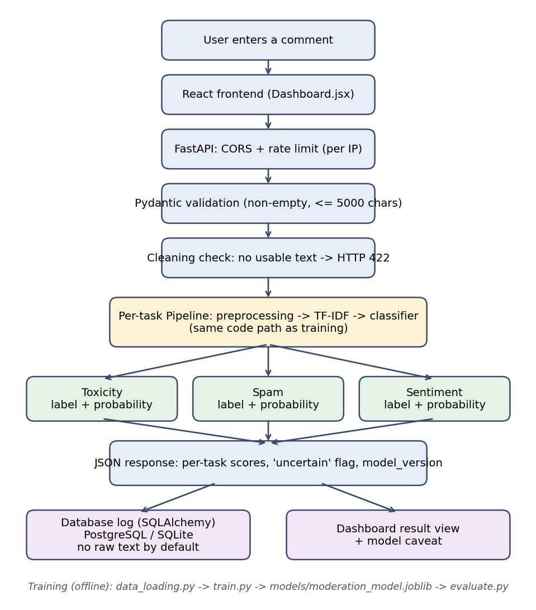

# AI Comment Moderation System — NLP Classification & Model Evaluation

An end-to-end machine-learning application that classifies short text comments for **toxicity**, **spam** and **sentiment**. It combines text preprocessing, TF-IDF features, scikit-learn classifiers, a FastAPI inference service, a React interface and automated tests. The project emphasises reproducible evaluation, input validation and transparent documentation of limitations.

> **Status: portfolio / proof-of-concept.** Models are trained on public tweet and SMS datasets and have measurable, documented weaknesses (see [Results](#experimental-evaluation) and [`docs/limitations.md`](docs/limitations.md)). The API has no authentication. It is not a production moderation system.

**Live demo:** Frontend <https://ai-comment-moderation-43h1.vercel.app/> · Backend <https://ai-comment-moderation-1.onrender.com> (the deployed instance may be running an older version until redeployed).

## Objectives

- Build and compare text classifiers using a rigorous, reproducible protocol (held-out test split, cross-validated model selection).
- Report metrics that expose class-level failures, not just accuracy.
- Serve the selected models through a validated, tested API with honest uncertainty reporting.

## Architecture



Training is offline (`train.py` → `models/moderation_model.joblib`); the API only loads the saved artifact. Preprocessing is part of each scikit-learn `Pipeline`, so training and inference use identical cleaning.

## Dataset and provenance

| Task | Dataset | Size (after de-dup) | Labels |
|---|---|---:|---|
| Toxicity | Davidson et al. 2017 hate-speech/offensive-language tweets | 24,723 | Toxic (hate or offensive) / Non-Toxic |
| Spam | SMS Spam Collection | 5,157 | Spam / Not Spam |
| Sentiment | Sanders Analytics Twitter corpus | 3,306 | Positive / Negative / Neutral |

Raw data is downloaded, not committed: `python scripts/download_data.py`. Sources, label mapping, de-duplication and **licence caveats** are in [`data/README.md`](data/README.md).

## Methodology

TF-IDF (word 1–2-grams) → Logistic Regression, Multinomial Naive Bayes or calibrated Linear SVC; hyper-parameters tuned by 5-fold CV (macro-F1) on the training split; model selected by CV score only; test set used once for reporting. A preprocessing ablation compares deleting vs. indicator-tokenising URLs/numbers. Full detail: [`docs/methodology.md`](docs/methodology.md).

## Experimental evaluation

Held-out test set (stratified 20%, seed 42), deployed model = Logistic Regression for all three tasks:

| Task | Test accuracy | Macro-F1 | Key class | Key-class precision / recall |
|---|---:|---:|---|---|
| Toxicity | 0.953 | 0.921 | Toxic | 0.988 / 0.955 |
| Spam | 0.991 | 0.980 | Spam | 0.976 / 0.953 |
| Sentiment | 0.709 | 0.618 | Negative | 0.543 / 0.562 |


Take-aways: toxicity and spam are strong *on their own test data*; sentiment is weak; Naive Bayes ranks differently by accuracy than by macro-F1; keeping URL/number indicators improved spam detection in CV. These results come from one split and one seed and **do not transfer automatically to YouTube/Instagram-style comments**. Full tables, per-class results and confusion matrices: [`experiments/evaluation_summary.md`](experiments/evaluation_summary.md).

## Error analysis

See [`docs/methodology.md#4-error-analysis`](docs/methodology.md) and `experiments/error_analysis_<task>.csv` (most confident mistakes). Examples include casual insults without profanity missed by the toxicity model, spam written in conversational style, and sentiment labels that are arguably ambiguous.

## Application features

- Per-task label and **predicted-class probability** (no combined cross-task score), with a **low-confidence flag** using a per-task threshold evaluated on training-fold predictions
- Full class-probability breakdown, model version, `/model-info` evaluation summary
- Empty or symbol-only comments are **rejected (HTTP 422)** rather than labelled "safe"
- Request history logged to PostgreSQL/SQLite (no raw text by default)
- Per-IP rate limiting, explicit CORS origins, generic error responses, liveness (`/health`) vs readiness (`/ready`)
- Process-local `/metrics` (resets on restart; database logs persist)

## Installation

```bash
git clone <your repo> && cd ai-comment-moderation
pip install -r backend/requirements.txt
python scripts/setup_nltk.py                    # NLTK corpora (one time)
cd backend && uvicorn main:app --reload --port 8000
```

A trained model (`backend/models/moderation_model.joblib`) is included. To retrain: `python scripts/download_data.py && cd backend && python train.py` (about 2 minutes on one CPU). To regenerate figures/reports from the saved model: `python evaluate.py`.

Frontend:

```bash
cd frontend && npm install && npm start      # http://localhost:3000
```

Docker: `docker-compose up --build` (backend + PostgreSQL). Without `DATABASE_URL` the backend uses a local SQLite file.

Configuration (environment variables): `CORS_ORIGINS` (comma-separated, default localhost:3000), `RATE_LIMIT` / `RATE_LIMIT_WINDOW`, `MODEL_PATH`, `DATABASE_URL`, `STORE_RAW_COMMENT`.

## API

`POST /moderate-comment` — body `{"comment": "..."}`. **Illustrative response shape** (values are an example, not a benchmark):

```json
{
  "comment": "Thanks, this was really helpful!",
  "status": "ok",
  "toxicity": "Non-Toxic",
  "spam": "Not Spam",
  "sentiment": "Positive",
  "scores": {
    "toxicity":  {"label": "Non-Toxic", "probability": 0.93, "uncertain": false},
    "spam":      {"label": "Not Spam",  "probability": 0.98, "uncertain": false},
    "sentiment": {"label": "Positive",  "probability": 0.81, "uncertain": false}
  },
  "all_scores": {"toxicity": {"Non-Toxic": 0.93, "Toxic": 0.07}, "...": {}},
  "model_version": "2.0.0"
}
```

`422` for empty / oversized / symbol-only comments · `429` when rate limited · `503` when models are not loaded. Other endpoints: `GET /health`, `GET /ready`, `GET /metrics`, `GET /model-info`, `GET /logs/recent`.

**Breaking change from v1:** the single averaged `confidence` field was removed (an average of probabilities from three unrelated tasks has no defensible meaning); use `scores[task].probability`.

## Testing

```bash
python scripts/setup_nltk.py
python -m pytest tests -v
```

The suite (run in CI via GitHub Actions) covers API contract and validation, punctuation-only regression, per-task score bounds, CORS, rate limiting, error-message leakage, readiness when the model is missing, preprocessing variants (URLs, negation, emoji, mixed language, missing NLTK data), model loading/format checks, evaluation metrics, and a training smoke test. A few smoke-canary predictions are included as sanity checks only; generalisation is measured by the held-out evaluation, not by these tests.

## Limitations and responsible use

Domain mismatch (tweets/SMS vs. other platforms), label noise, weak sentiment model, unmeasured demographic bias, false positives/negatives, privacy and security status, and the need for human review are documented in [`docs/limitations.md`](docs/limitations.md) and [`SECURITY.md`](SECURITY.md).

## Future improvements

- Evaluate on a sample of real target-platform comments, with a second annotator, before trusting any number for that setting
- Repeat the split with several seeds / report confidence intervals
- Measure per-group error rates for dialect and identity terms
- Probability calibration on a dedicated validation set
- Authentication and shared-store rate limiting for any public deployment
- Compare against a fine-tuned transformer as a (clearly labelled) stretch experiment

## Repository layout

```
backend/        main.py  model.py  preprocess.py  data_loading.py  train.py  evaluate.py  db.py  models/
frontend/       React dashboard
data/           README.md (raw files downloaded to data/raw/, git-ignored)
experiments/    model_comparison.csv  preprocessing_ablation.csv  evaluation_summary.md  error_analysis_*.csv  model_metadata.json
reports/figures/  confusion matrices, model comparison
docs/           architecture.png  methodology.md  limitations.md
scripts/        download_data.py  setup_nltk.py
tests/          API, preprocessing, model, evaluation tests
screenshots/    UI screenshots (taken before v2 — see note below)
```

> Screenshots in `screenshots/` predate the v2 UI (they show the old single "Confidence" bar). Re-capture them after running the updated frontend.

MIT © 2025
